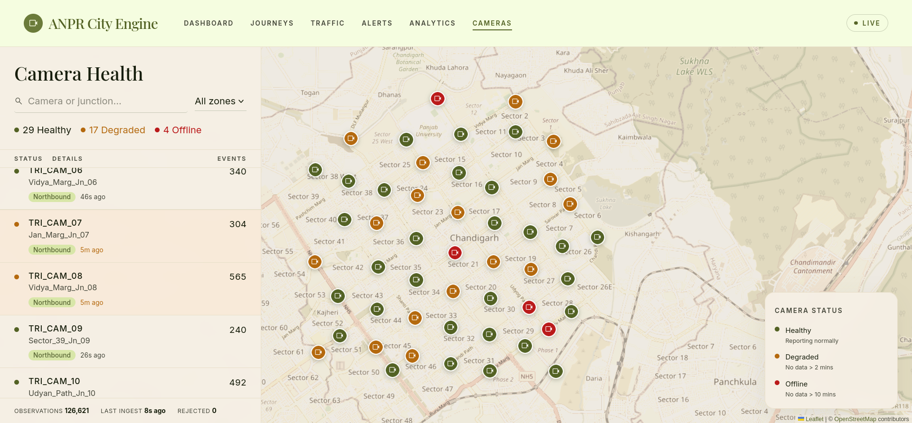
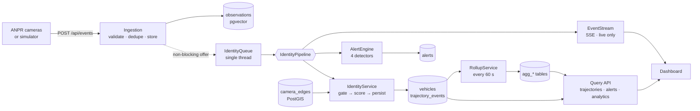

<div align="center">

# ANPR City Engine

**Follows vehicles across a city using the junction cameras it already has, including when a plate can't be read.**

Turns separate number-plate camera sightings into road-accurate journeys, live alerts and traffic analytics.




<sub>The <b>Camera Health</b> view of the companion React + Leaflet dashboard, running on this backend: 50 cameras across Chandigarh, Mohali and Panchkula, with 126,621 observations ingested and 0 rejected.</sub>

</div>

---

## The problem

Most cities already have ANPR cameras on their main junctions. On its own, each camera can only tell you *which vehicles passed this point*. It can't tell you where a car came from, where it went next, or whether the same plate just showed up on the other side of town.

Joining those sightings up is harder than it sounds:

- **Plates get misread.** `CH01AB1234` can come through as `CHO1A81234`.
- **Plates go unread.** At night, in rain or behind a motorcycle, the camera may read nothing at all.
- **Plates get cloned.** Two different cars can carry the same registration.

A plain plate-matching database breaks on all three. This engine combines **plate text, travel time over the real road network, and visual appearance** to work out which sightings belong to the same physical vehicle.

## Highlights

| | |
| --- | --- |
| 🧭 **Three-signal identity resolution** | Plate similarity (exact, confusable-character skeleton, edit distance), log-normal travel-time fit and 512-d appearance embeddings are combined into one score. A link is accepted only if it clears a threshold **and** beats the runner-up by a margin. A wrong link corrupts two journeys, while a missed link only splits one. |
| 🌫️ **Works without a readable plate** | Vehicles are matched on appearance and timing alone. With 30% of plates unreadable, **803 of 803** null-plate links were recovered correctly. |
| 🚨 **Cloned-plate detection** | If one registration shows up on two vehicles that look different, or at two points faster than any road allows, both vehicles are flagged. The check reuses the resolver's own record of why it *refused* each link. |
| 🗺️ **Road graph built from the map** | Edges between cameras come from OSRM driving routes, with real geometry and expected travel times. They aren't drawn by hand. |
| 📡 **Live alerts over SSE** | Four detectors run on every sighting: watchlist, restricted zone, impossible speed and plate/appearance mismatch. Repeat alerts for the same vehicle collapse into one row with a count. |
| 📊 **Analytics with flat query cost** | Heatmap, congestion, density and origin-destination flows are read from pre-aggregated rollups, so query time depends on the number of buckets, not on how much history is stored. Each OD response also reports the share of vehicles it could actually use. |
| 🏙️ **New city by config change** | Cameras live in a JSON file. Change `CAMERA_SET`, regenerate the graph, and the map, simulator and analytics all use the new city. |
| 🧪 **Built-in simulator with ground truth** | Generates realistic traffic with tunable OCR errors, dropped plates, appearance noise and congestion. Identity accuracy is scored against the ground truth (precision, recall, fragmentation). |

## Architecture



**Design decisions**

- **Ingestion accepts the event and returns.** Field devices give up after two seconds, so everything expensive runs behind a queue. A full queue drops events rather than blocking, so identity resolution can never slow ingestion down.
- **The resolver is a pure function.** It takes facts and candidates and returns a decision plus the rejected candidates. It reads and writes nothing, which makes it unit-testable. Clone detection is built on those rejection reasons.
- **Live and batch use the same code.** `POST /api/identity/rebuild` replays all history in time order through the same pipeline the live path uses. There is no second copy of the logic.
- **Malformed payloads are kept.** The controller reads the raw body, so a request that fails validation is stored verbatim along with the reason.
- **Analytics reads only from rollups.** Ranges are half-open and ranked results have a tiebreaker, so the same query returns the same answer every time.
- **Swallowed failures are counted.** Alerting and streaming are wrapped in catch-alls so they can't break resolution. Each catch also increments a counter on `/api/health/system`, so a broken query shows up as a rising number instead of looking like a quiet day.

## How a sighting becomes a journey

1. **Gate.** Candidate vehicles come only from cameras with a road edge to this one, inside that edge's travel-time window, plus a plate-skeleton fallback pool. The resolver never scans every vehicle.
2. **Score.** Each candidate gets points from three signals:

   | Signal | Contribution |
   | --- | --- |
   | Plate | exact `+6` · skeleton (`O→0 I→1 B→8 S→5 Z→2 G→6`) `+4` · edit distance 1 `+2` · distance 2 `+0.5` · further than that: rejected |
   | Travel time | up to `+2`, from a log-normal fit around the edge's typical time |
   | Appearance | cosine-similarity bands: strong `+5` · weak `+2` · neutral `0` · mismatch `−3` |

3. **Decide.** The top candidate needs a total of at least **4.0** and a lead of at least **1.0** over the runner-up. Otherwise a new vehicle is started.
4. **Persist and react.** The link and its confidence are written, the appearance centroid is recomputed in SQL as `l2_normalize(avg(embedding))`, the detectors run, and the sighting is pushed to live dashboards.

Each trajectory comes back as map-ready **GeoJSON** that follows real roads. Every hop is marked `inferred`, because only the cameras at each end of a hop actually saw the vehicle. Where there is no road geometry, the hop is a straight line labelled as such. Cameras that should have seen the vehicle but didn't are flagged too.

## Tech stack

| Layer | Choice | Why |
| --- | --- | --- |
| Runtime | Java 21, Spring Boot 3.3 | Records for DTOs, scheduled rollups, SSE out of the box |
| Storage | PostgreSQL 16 | One database for relational, spatial and vector data |
| Spatial | PostGIS 3.4 | Road geometry stored and returned as GeoJSON with `ST_AsGeoJSON` |
| Vectors | pgvector 0.8 | 512-d embeddings with cosine distance (`<=>`) computed in SQL |
| Migrations | Flyway | Schema plus generated road-graph seed |
| Routing | OSRM (offline tooling only) | Builds the camera-to-camera road graph |
| Packaging | Docker Compose | Health-checked Postgres and backend, started in order |

## Quick start

```bash
git clone https://github.com/TheNobady/ANPR-Backend.git && cd ANPR-Backend
docker compose up --build -d
until curl -sf localhost:8000/actuator/health >/dev/null; do sleep 2; done
```

Docker is the only requirement. The build pins JDK 21, applies the migrations, loads the camera set and serves the API on **:8000**. If ports are taken: `DB_PORT=55432 APP_PORT=8001 docker compose up -d`.

### Generate two hours of traffic and score the result

```bash
# ~2 hours of history, timestamped in the past, generated in seconds
curl -X POST localhost:8000/api/sim/backfill -H 'Content-Type: application/json' \
  -d '{"hours": 2, "congestionFactor": 2.6}'

# Re-resolve all of it in time order and rebuild the analytics
curl -X POST localhost:8000/api/identity/rebuild

# Score identity resolution against the simulator's ground truth
curl localhost:8000/api/identity/evaluate | jq '.link_precision, .fragmentation'

# Then watch it live
curl -N localhost:8000/api/stream &
curl -X POST localhost:8000/api/sim/start -H 'Content-Type: application/json' \
  -d '{"vehiclesPerMinute": 30}'
```

`scripts/demo-50.sh` sets up and starts the full 50-camera Tricity demo from any database state.

## API at a glance

| Endpoint | Purpose |
| --- | --- |
| `POST /api/events` | Camera ingestion. Idempotent on `(camera_id, tracklet_id)` |
| `GET /api/cameras` · `GET /api/graph` | Cameras and road network as GeoJSON, with map bounds and suggested zoom |
| `GET /api/vehicles/{id}/trajectory` | A journey as alternating Point / LineString features, with confidence on each hop |
| `GET /api/trajectory?plate=` | Look up a journey by plate: exact match first, then skeleton, then fuzzy |
| `GET /api/alerts` · `GET /api/stream` | Alert feed and live Server-Sent Events |
| `GET /api/analytics/{heatmap,congestion,density,od,summary}` | Traffic analytics over any time range (default: the last 15 minutes) |
| `GET\|POST /api/blacklist` · `/api/restricted-zones` | Watchlist and zone rules. Changes apply from the next sighting, no restart |
| `POST /api/identity/rebuild` · `GET /api/identity/evaluate` | Re-resolve all history · score it against ground truth |
| `GET /api/health/system` | Counts, last ingest time and swallowed-failure counters |

Responses contain no presentation values. The server reports facts (confidence, band, `geometry_source`, `inferred`) and the client decides how to show them.

## Scripted demo scenarios

`scenarios/demo.json` runs set pieces on top of the random background traffic:

- **`CH01ZZ9999`.** The plate is deliberately dropped at the third of four cameras, and the vehicle still comes out as one journey, linked on appearance and timing.
- **`CH01AB1234`.** A blacklisted lorry crosses five cameras and raises **one** alert with `repeat_count: 5`. It also trips a restricted-zone rule.
- **`CH04CL0NE`.** Two differently coloured cars with the same plate are seen 3.6 km apart, 15 s apart (about 860 km/h). This raises both `impossible_speed` and `plate_appearance_mismatch`, and each alert names the other vehicle.

## Lessons from building it

- **Camera placement determines the graph.** Putting cameras on intersection centroids gave **18 edges and 8 isolated cameras**. Moving each one 110 m back along its approach and 9 m onto the correct carriageway gave **73 edges and none isolated**. The cause: OSRM snaps a point to the nearest road, so a route's first segment pointed in whatever direction the snap went and failed the heading filter.
- **Embedding thresholds belong to the model.** The appearance bands are tuned to the simulator (same vehicle ≈ 0.58, different ≈ 0.00). A real re-ID model sits around 0.85 or higher. If you swap models without re-measuring, recovery of unreadable plates silently drops to zero while precision still reads 1.00. The calibration query is leave-one-out, because a centroid that contains the observation being scored makes the match look better than it is.
- **Order matters for greedy linking.** The simulator posts history from eight threads, and greedy linking is only meaningful in time order. That is why the rebuild endpoint exists.

## Project layout

```
src/main/java/com/anpr/backend/
  ingest/       /api/events contract, validation, reject capture
  camera/       camera entity, camera-set loader, map bootstrap
  graph/        camera_edges + OSRM graphgen / graphcheck tools
  identity/     gating, scoring, pure resolver, rebuild, evaluation
  trajectory/   one-query GeoJSON trajectory assembly
  alert/        watchlist cache, four detectors, suppression
  stream/       SSE registry with live-window gate
  analytics/    rollups and aggregate queries
  sim/          traffic simulator and scenarios (profile: sim)
src/main/resources/camera-sets/   chandigarh · tricity (50 cams) · agra
scenarios/                        scripted demo vehicles
```

## Further reading

- **[docs/TECHNICAL.md](docs/TECHNICAL.md)** — the full reference: every endpoint, every config key, the demo script, adding a new city, and calibrating the appearance thresholds.
- **[Explain.md](Explain.md)** — the whole system explained in plain language.

## Scope

There is no authentication or role-based access yet; the admin endpoints are open on purpose. Don't expose this to an untrusted network as it stands.

---

<div align="center">
Built by <b>Ojas Sharma</b>
</div>
